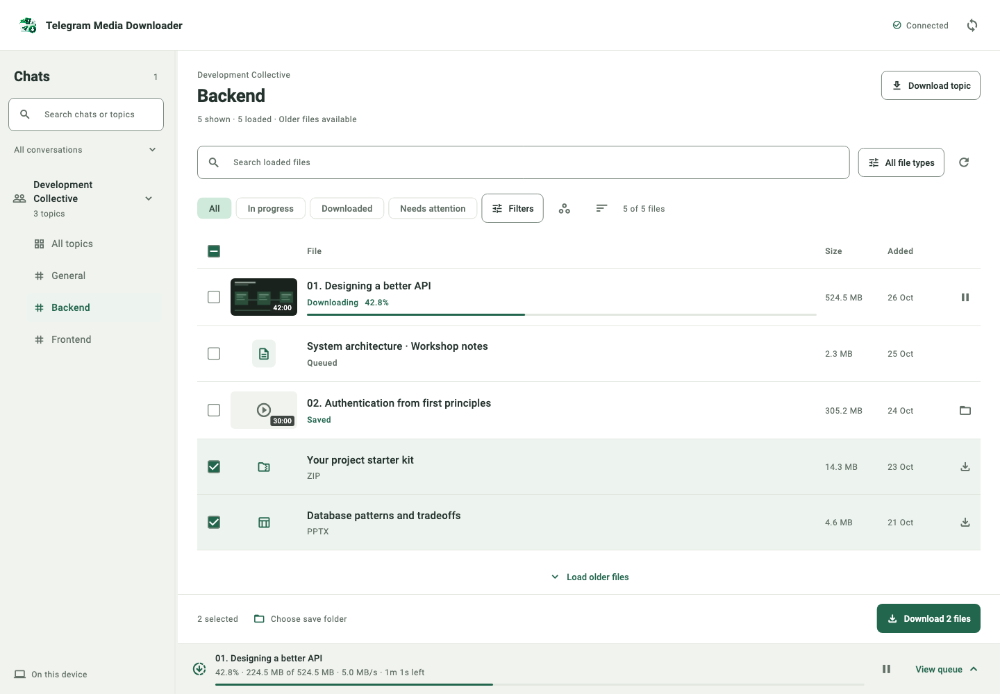

<p align="center">
  
</p>

# Telegram Media Downloader

Repository: [manishrelani/telegram-media-downloader](https://github.com/manishrelani/telegram-media-downloader).

Browse your Telegram media. Download the files you choose. Keep them organized on your Mac.

Telegram Media Downloader is a local desktop app for browsing chats and forum topics, choosing videos and documents, and following each file from the download queue to its saved folder. It uses Flutter, a Go backend and a bundled, patched [tdl](https://github.com/iyear/tdl) runtime.

[Get started](docs/GETTING_STARTED.md) · [Troubleshooting](docs/TROUBLESHOOTING.md) · [Build from source](docs/DEVELOPMENT.md) · [Contribute](CONTRIBUTING.md)



*Interface preview with sample data.*

## Download

Open [GitHub Releases](https://github.com/manishrelani/telegram-media-downloader/releases) and choose a macOS app ZIP from a published release. The release notes identify the supported architecture, signing status and known limitations. Extract the ZIP and move the app to Applications.

**Current target: macOS on Apple Silicon.** Windows and Linux source support is experimental; native distribution and end-to-end validation are pending.

GitHub's automatically generated **Source code** archives contain source files. Choose the separately attached **macOS app ZIP** to run the app. If no app release is listed yet, [build it from source](docs/DEVELOPMENT.md).

The project distributes directly through GitHub. No app-store installation or project-owned server is needed. Download verification, first launch, Telegram login and updates are covered in [Getting started](docs/GETTING_STARTED.md).

## What you can do

- Browse chats and forum topics; load recent media first and older files when needed.
- Choose individual files or explicitly download a whole chat/topic with selected file types.
- Combine videos, images, audio, PDFs, Office files and other document categories.
- Track each file's progress and status; pause, resume, cancel or retry where supported.
- Filter and sort the media browser and download history by relevant file and download details.
- Preview videos with thumbnails that appear as they become available.
- Save caption-based filenames, avoid overwriting collisions and skip recorded files that are still present.
- Use light/dark appearance, keyboard navigation and a resizable chat sidebar.

Start with the [five-step download walkthrough](docs/GETTING_STARTED.md#download-your-first-files).

## How it works

```text
Flutter desktop app → local Go backend → bundled tdl runtime → Telegram
                            ↓
                   selected save folder
```

The Go backend manages the queue, filenames, saved-file checks and progress events. `tdl` handles Telegram authentication and media transfers using your account. A separate app-owned helper fetches still-image thumbnails.

The macOS bundle includes its required Go executables. Users of the app ZIP do not need Go, Flutter or a separate global `tdl` installation. First-time Telegram login currently uses a Terminal command supplied in the user guide.

See [Dependencies and tdl integration](docs/DEPENDENCIES.md) for the pinned runtime, upstream documentation, licenses and how dependency updates are handled.

## Status and limits

This is an early project. Automated tests, synthetic integration checks and local macOS builds have been run; real-account transfers, checksum-verified interruption/recovery and native external-drive interactions still need broader acceptance testing.

- Your Telegram account must have access to the media; Telegram restrictions and rate limits still apply.
- Search operates on loaded results. Use **Load older** to expand the browser.
- Progress depends on telemetry from the runtime; missing percentage information is shown without inventing progress.
- Preview quality depends on the thumbnail Telegram provides.
- Downloads use private working storage before final copying, so allow space on the app-state volume and the selected destination.
- Windows graceful pause is currently unavailable. Other Windows/Linux behavior needs native verification.

[Release checklist](docs/RELEASING.md) · [Detailed media behavior](docs/MEDIA_LIBRARY.md)

## Help and contributions

Read [Troubleshooting](docs/TROUBLESHOOTING.md), then use [this repository's issue forms](https://github.com/manishrelani/telegram-media-downloader/issues/new/choose) for reproducible bugs or feature proposals. Include app/runtime versions and sanitized errors. Report suspected vulnerabilities privately using [SECURITY.md](SECURITY.md).

Documentation fixes, tests, accessibility improvements and platform validation are welcome. [CONTRIBUTING.md](CONTRIBUTING.md) explains setup, TDD, pull requests and commit conventions.

## Privacy and responsible use

The app has no project-owned cloud service. Telegram operations still use the network and your local Telegram session. Keep sessions, login codes, exports and private message content out of issues and commits. Download content you are authorized to access and save.

This project is independent of Telegram and the upstream tdl project.

## License and acknowledgements

The project's original code is licensed under the **GNU Affero General Public License, version 3 (AGPL-3.0-only)**. See [LICENSE](LICENSE) for the full terms. Third-party components retain their respective licenses and notices.

The bundled tdl runtime and preview helper use AGPLv3 components. Upstream notices and dependency sources are retained. See [Dependencies and licensing](docs/DEPENDENCIES.md#licensing-and-corresponding-source).

Thanks to [tdl](https://github.com/iyear/tdl), [gotd](https://github.com/gotd/td), [Flutter](https://flutter.dev/) and the other dependencies that make this app possible.
